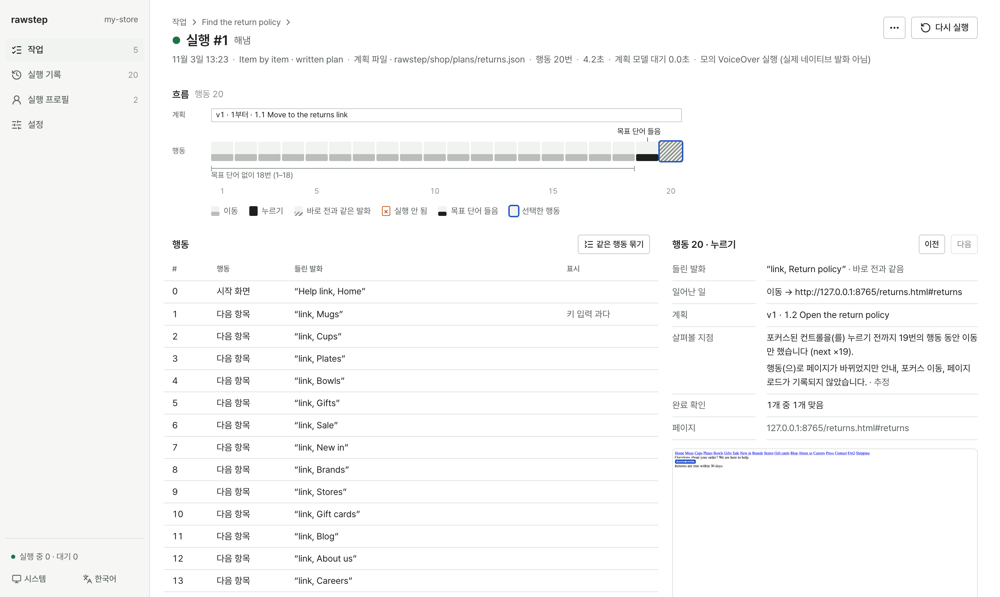

# Rawstep

**버튼이 있는지만 확인하지 않고, 스크린리더로 그곳까지 찾아가는 과정을 테스트합니다.**

Rawstep은 스크린리더 사용자가 웹 페이지에서 목표를 수행하는 과정을 시뮬레이션하고, 매 단계에서 들린 음성과 이동 기록을 바탕으로 어디서 헤맸는지, 몇 번 만에 도달했는지, 어떤 요소가 반응하지 않았는지를 리포트로 정리해 주는 도구입니다.

[](https://nodejs.org/)
[](./LICENSE)

[English Documentation](./README.md)



---

## 왜 Rawstep을 쓰나요?

정적 접근성 검사 도구(`axe-core`, Lighthouse 등)는 버튼에 이름이 있는지, 속성이 맞는지를 확인합니다. 일반적인 E2E 테스트는 셀렉터로 요소를 바로 집어서 클릭했을 때 동작하는지를 봅니다.

하지만 실제 스크린리더 사용자는 셀렉터로 건너뛰지 못합니다. 설령 목표 버튼에 최종적으로 도달할 수 있더라도, 그곳까지 찾아가는 과정 자체가 험난할 수 있습니다:
- 페이지에 적절한 제목 구조가 없어서 상단 메뉴부터 스무 번 넘게 항목을 하나씩 넘겨야 하는 경우
- 장바구니 담기나 토글 버튼을 눌렀을 때 화면은 바뀌었지만 아무런 음성 안내가 나오지 않아 동작 여부를 알 수 없는 경우
- 모달이나 배너를 닫았더니 초점이 `<body>`로 풀려 페이지 맨 위부터 다시 찾아가야 하는 경우
- 모달 다이얼로그가 열렸는데 초점이 모달 바깥 배경 페이지에 남아 있는 경우
- 링크나 입력창 이름이 모호해서 앞뒤로 왔다 갔다 하며 헤매는 경우

Rawstep은 이런 과정을 직접 돌려보고 리포트로 확인하기 위해 만들어졌습니다:
1. **스크린리더 음성만 듣고 이동:** 모델에게 HTML 소스나 CSS 셀렉터, 화면 캡처를 주지 않습니다. 오직 스크린리더가 읽어주는 텍스트만 듣고 움직입니다. 별도 설정 없이 바로 쓸 수 있는 내장 모의 VoiceOver와, W3C AT Driver를 통한 실제 macOS VoiceOver 및 Windows NVDA를 지원합니다.
2. **계획 기반 실행:** 매 이동마다 모델을 호출하는 대신, 모델(클라우드 API, 로컬 코딩 에이전트 CLI, 또는 미리 작성한 `plan.json` 파일)이 탐색 계획(`plan.md`)을 세우면 러너가 목표 단서가 들릴 때까지 이동하며 실행하고, 막히면 계획을 고쳐 다시 시도합니다.
3. **완료 조건 별도 확인 (`verify.all`):** 모델이 스스로 끝났다고 판단하더라도 그대로 믿지 않습니다. 작업 파일에 적어둔 완료 조건(URL·제목 변경, 화면 텍스트, 네트워크 요청, 초점·라이브 리전 이벤트 등)을 브라우저에서 따로 확인합니다.
4. **과정 중심의 리포트:** 실행이 어떻게 끝났는지(목표 도달, 중도 포기, 완료로 착각, 측정 불가), 몇 번 이동했는지, 어디서 기대와 다르게 동작했는지를 `report.html`과 `hints.json`으로 정리합니다.

> [!NOTE]
> Rawstep은 개발과 CI 단계에서 탐색 중 겪는 불편을 찾아내는 도구입니다. 힌트는 살펴볼 만한 지점을 알려줄 뿐, WCAG 준수를 인증하거나 실제 스크린리더 사용자와 함께하는 테스트를 대신하지 않습니다.

---

## 시작하기

### 요구 사항
- **Node.js** `>= 22.12.0`
- 로컬에 설치된 **Google Chrome** 또는 Playwright Chromium (`npx playwright install chromium`)

### 설치 (npm 배포 전)

Rawstep은 아직 npm에 배포되지 않아서 `npx rawstep`이 레지스트리에서 패키지를 받아 올 수 없습니다. 이 저장소에서 패키지를 만들어 내 프로젝트에 설치하면, 아래의 `npx rawstep` 명령은 모두 그 로컬 설치본을 실행합니다.

```bash
# 이 저장소를 클론한 폴더에서
corepack pnpm install --frozen-lockfile
npm run pack:rawstep

# 내 프로젝트 폴더에서
npm install /absolute/path/to/rawstep/artifacts/rawstep-<version>.tgz
```

### 1. 프로젝트 초기화 및 데모 실행

`rawstep init`은 기본 설정 파일(`rawstep.config.json`)과 함께 `rawstep/demo/` 폴더에 데모 페이지, 작업, 미리 작성한 계획(`page.html`, `task.json`, `plan.json`)을 만들고 실행 프로필 두 개(`written-plan`, `item-by-item`)를 추가합니다. API 키 없이 바로 실행해 볼 수 있습니다:

```bash
npx rawstep init
npx rawstep run demo
```

### 2. 로컬 대시보드 열기

```bash
npx rawstep ui
```

브라우저에서 `http://127.0.0.1:4318`이 열립니다. 대시보드에서 AI 연결(OpenAI, Anthropic, Google, OpenRouter 또는 별도 API 키 없이 기존 로그인을 쓰는 **Claude Code**, **Codex**, **opencode**, **Grok Build**, **Antigravity** CLI), 실행 프로필(한 칸씩, 제목으로, 폼 컨트롤로, 링크로 찾기), 작업 생성(**AI 제안 받기**로 실제 페이지를 읽고 완료 확인 조건 제안 받기) 및 실행 결과 비교를 관리할 수 있습니다.

### 3. 환경 점검

```bash
npx rawstep doctor
```

Node 버전, `rawstep.config.json`, 작업 파일, 브라우저 실행, 모델 연결, 그리고 (설정했다면) 실제 스크린리더용 AT Driver 엔드포인트를 점검합니다.

---

## 자주 쓰는 CLI 명령

```bash
# 특정 실행 프로필로 작업 실행 (`by-headings`, `linear`은 설정 파일에 직접 정의한 프로필 id 예시입니다)
npx rawstep run checkout --profile by-headings

# 3번 반복 실행하고 가장 빨리 끝난 실행과 비교
npx rawstep run checkout --repeat 3

# "smoke" 태그가 붙은 모든 작업을 두 프로필로 실행하고 베이스라인 요약 저장
npx rawstep suite --tag smoke --profile linear --profile by-headings --save-summary baseline.json

# CI에서 새 실행 결과를 커밋된 베이스라인과 비교 (회귀가 있으면 종료 코드 4)
npx rawstep suite --tag smoke --baseline baseline.json --fail-on reach,moves,stuck --junit results.xml

# 저장된 실행 폴더에서 마찰 힌트를 보거나 단독 HTML 리포트 만들기
npx rawstep hints .rawstep/experiments/<batch-id>/<run-id>
npx rawstep report .rawstep/experiments/<batch-id>/<run-id>
```

---

## 문서 안내

### 가이드
- **[시작하기](./docs/getting-started.ko.md)** — 설치, 데모 실행, AI 모델 연결, 첫 태스크 만들기
- **[핵심 개념](./docs/concepts.ko.md)** — 태스크, 실행 프로필, 4가지 종료 상태, 이동 횟수, 막힌 지점과 마찰 힌트
- **[계획 수립 및 AI 모델](./docs/planning.ko.md)** — 계획 문서(`plan.json` / `plan.md`)가 동작하는 방식과 모델·CLI·계획 파일 연결
- **[스크린리더 및 탐색 모드](./docs/screen-readers.ko.md)** — 시뮬레이션된 VoiceOver와 실제 VoiceOver/NVDA 설정, 탐색 모드
- **[CI 및 베이스라인 회귀 테스트](./docs/ci.ko.md)** — `rawstep suite`, 베이스라인 요약(`summary.json`) 비교, `--fail-on` 설정 및 GitHub Actions 연동

### 레퍼런스
- **[CLI 레퍼런스](./docs/reference/cli.ko.md)** — CLI 명령어(`init`, `ui`, `run`, `suite`, `compare`, `hints`, `report`, `analyze`, `doctor`), 옵션 및 종료 코드
- **[설정 파일 레퍼런스](./docs/reference/config.ko.md)** — `rawstep.config.json` 전체 설정 필드와 `runRules`
- **[태스크 파일 레퍼런스](./docs/reference/task.ko.md)** — 태스크 JSON 형식, `verify.all` 완료 규칙, 입력값 보호 및 브라우저 설정
- **[결과, 트레이스 및 힌트 레퍼런스](./docs/reference/results.ko.md)** — `.rawstep/` 폴더 구조, `summary.json`, `trace.json`, 16종 마찰 힌트 목록
- **[TypeScript 프로그래밍 API](./docs/reference/api.ko.md)** — 코드에서 `rawstep/*` 모듈 직접 호출하기

---

## 라이선스

[MIT](./LICENSE). 서드파티 데이터 및 소프트웨어 고지는 [THIRD-PARTY-NOTICES.md](./THIRD-PARTY-NOTICES.md)를 참고하세요.
