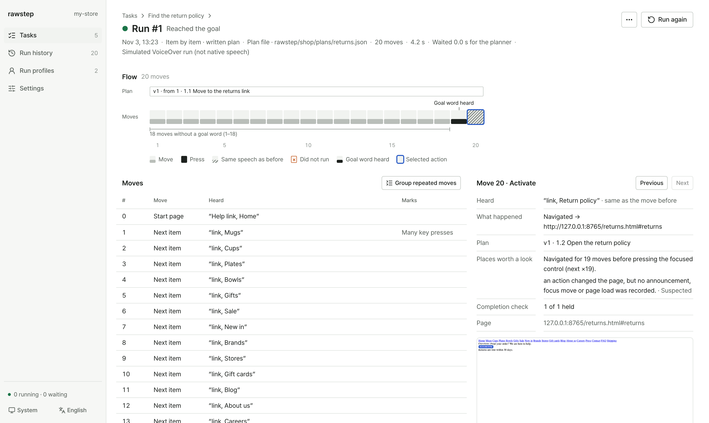

# Rawstep

**Test how a screen-reader user gets to the button, not just whether the button exists.**

Rawstep simulates a screen-reader user navigating your web page to complete a task, records what was spoken at each step, and points out where the run got slow, lost focus, hit an unresponsive control, or changed the page without announcing it.

[](https://nodejs.org/)
[](./LICENSE)

[한국어 안내](./README.ko.md)



---

## Why Rawstep?

Static accessibility checkers (`axe-core`, Lighthouse) check whether buttons have names and inputs have labels. Standard E2E tests (`page.getByRole('button').click()`) check whether clicking an element works when you jump straight to it.

Neither tells you what it takes for a screen-reader user to find that button on their own. Even when a control is technically reachable, getting there can be rough:
- Stepping through 30 header and sidebar items because headings are missing or out of order.
- Pressing a toggle or "Add to Cart" button that updates the screen visually without announcing anything over speech or `aria-live`.
- Closing a dialog or banner and having focus drop back to `<body>`, forcing the user to start over from the top of the page.
- Opening a modal dialog while focus stays on the background page behind it.
- Moving back and forth because link text or form labels are vague.

Rawstep runs through the page under those same conditions and writes a report of what happened:
1. **Hears only what the screen reader says:** The model never receives your HTML source, CSS selectors, or screenshots. It only hears spoken output from a screen reader—either the built-in **Simulated VoiceOver** or a real **macOS VoiceOver** / **Windows NVDA** over the W3C AT Driver protocol.
2. **Plans and follows steps:** Instead of calling an LLM on every keystroke, a planner (a cloud API, a local coding-agent CLI like Claude Code / Codex, or a saved `plan.json` file) writes a navigation plan (`plan.md`), and Rawstep's runner follows each step until it hears the expected cue or needs to revise the plan.
3. **Checks completion independently (`verify.all`):** The simulated user cannot mark its own run as passed. Rawstep checks your completion rules (URL/title changes, visible text, network requests, or focus/live-region events) separately in the browser.
4. **Reports friction, not just pass/fail:** Every run records how it ended (`reached`, `gave-up`, `mistaken`, or `unmeasured`), how many moves it took, where expectations broke, and a list of friction hints in `report.html` and `hints.json`.

> [!NOTE]
> Rawstep is a tool for spotting navigation friction during development and CI. Its hints point to places worth reviewing—they do not certify WCAG compliance or replace testing with real screen-reader users.

---

## Quickstart

### Requirements
- **Node.js** `>= 22.12.0`
- **Google Chrome** installed locally, or Playwright Chromium (`npx playwright install chromium`)

### Install (before the npm release)

Rawstep is not published to npm yet, so `npx rawstep` cannot fetch it from the registry. Build the package from this repository and install it into your project; after that, every `npx rawstep` command below runs that local copy.

```bash
# In a clone of this repository
corepack pnpm install --frozen-lockfile
npm run pack:rawstep

# In your project
npm install /absolute/path/to/rawstep/artifacts/rawstep-<version>.tgz
```

### 1. Initialize a project and run the demo

`rawstep init` creates `rawstep.config.json` and a demo page, task, and pre-written plan under `rawstep/demo/` (`page.html`, `task.json`, `plan.json`), plus two run profiles (`written-plan` and `item-by-item`), so you can run it right away without an API key:

```bash
npx rawstep init
npx rawstep run demo
```

### 2. Open the local dashboard

```bash
npx rawstep ui
```

Opens `http://127.0.0.1:4318`. From the dashboard you can:
- Connect an AI provider (OpenAI, Anthropic, Google, OpenRouter) or a local coding-agent CLI (**Claude Code**, **Codex**, **opencode**, **Grok Build**, **Antigravity**) using its own login.
- Create tasks and use **Get AI suggestions** to have an LLM propose completion checks from the live page.
- Choose how the simulated user navigates (**Item by item**, **By headings**, **By form controls**, or **By links**).
- Run single tasks or multi-profile batches and inspect the spoken timeline, plan revisions, and friction hints.

### 3. Check your setup

```bash
npx rawstep doctor
```

Checks your Node version, `rawstep.config.json`, task files, browser launch, model connections, and native AT Driver endpoints (if configured).

---

## Common CLI Commands

```bash
# Run a task with a specific run profile (`by-headings` and `linear` below are profile ids you defined yourself)
npx rawstep run checkout --profile by-headings

# Run 3 repeats and compare against the fastest run
npx rawstep run checkout --repeat 3

# Run all tasks tagged "smoke" across two profiles and save a baseline summary
npx rawstep suite --tag smoke --profile linear --profile by-headings --save-summary baseline.json

# Compare a new batch against a committed baseline in CI (exits with code 4 on regressions)
npx rawstep suite --tag smoke --baseline baseline.json --fail-on reach,moves,stuck --junit results.xml

# List friction hints or build a standalone HTML report from a saved run folder
npx rawstep hints .rawstep/experiments/<batch-id>/<run-id>
npx rawstep report .rawstep/experiments/<batch-id>/<run-id>
```

---

## Documentation

### Guides
- **[Getting Started](./docs/getting-started.md)** — Install Rawstep, run the demo, connect a model or agent CLI, and create your first task.
- **[Core Concepts](./docs/concepts.md)** — How tasks, run profiles, the 4 run endings (`reached`, `gave-up`, `mistaken`, `unmeasured`), move counts, stuck places, and friction hints work.
- **[Planning & AI Models](./docs/planning.md)** — How plans (`plan.json` / `plan.md`) are written, followed, and revised, plus using cloud APIs, coding-agent CLIs, or saved plan files.
- **[Screen Readers & Navigation Modes](./docs/screen-readers.md)** — Simulated VoiceOver vs. native macOS VoiceOver and Windows NVDA, rotor lists, and navigation modes.
- **[CI & Baseline Regression Testing](./docs/ci.md)** — Running suites, saving `summary.json` baselines, `--fail-on` gates, JUnit XML, and GitHub Actions.

### Reference
- **[CLI Reference](./docs/reference/cli.md)** — All 9 commands (`init`, `ui`, `run`, `suite`, `compare`, `hints`, `report`, `analyze`, `doctor`), flags, `--rule` overrides, and exit codes.
- **[Configuration Reference (`rawstep.config.json`)](./docs/reference/config.md)** — `connections`, `profiles`, `runRules`, `tasks`, `project`, `machine`, and `.env.local`.
- **[Task File Reference](./docs/reference/task.md)** — Task JSON fields, all 13 `verify.all` rules, input masking, navigation guards, and browser connection modes.
- **[Results, Traces & Hints Reference](./docs/reference/results.md)** — `.rawstep/` folder layout, `summary.json`, `trace.json`, and all 16 friction hints.
- **[Programmatic TypeScript API](./docs/reference/api.md)** — Calling `runTask`, `runSuite`, `extractHints`, and custom policies from code (`rawstep/*`).

---

## License

[MIT](./LICENSE). See [THIRD-PARTY-NOTICES.md](./THIRD-PARTY-NOTICES.md) for third-party attributions.
