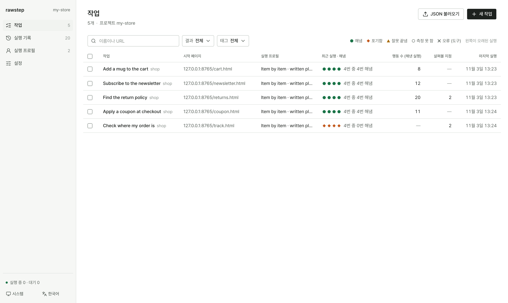
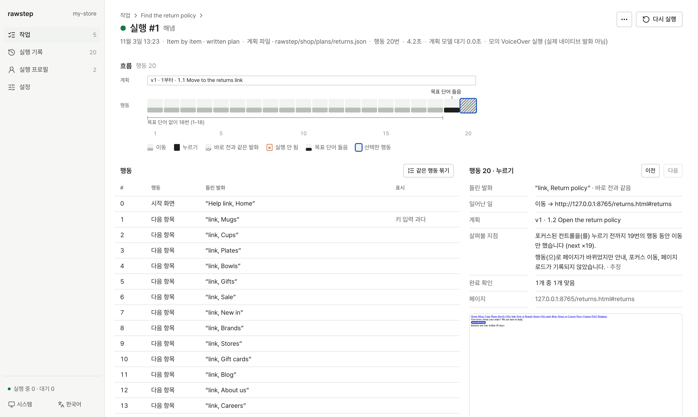

# 시작하기

설치부터 첫 실행까지 1분이면 충분합니다.

## 준비물

- **Node.js** `22.12.0` 이상
- **Chrome** 브라우저 (없다면 `npx playwright install chromium`)

## 설치 (npm 배포 전)

Rawstep은 아직 npm에 배포되지 않아서 `npx rawstep`이 레지스트리에서 패키지를 받아 올 수 없습니다. 이 저장소에서 패키지를 만들어 내 프로젝트에 설치하면, 문서의 `npx rawstep` 명령은 모두 그 로컬 설치본을 실행합니다.

```bash
# 이 저장소를 클론한 폴더에서
corepack pnpm install --frozen-lockfile
npm run pack:rawstep

# 내 프로젝트 폴더에서
npm install /absolute/path/to/rawstep/artifacts/rawstep-<version>.tgz
```

---

## 1. 데모 먼저 돌려보기

프로젝트 폴더에서 아래 두 줄을 실행해 보세요. API 키 없이 바로 동작합니다.

```bash
npx rawstep init
npx rawstep run demo
```

`rawstep/demo/` 폴더에 만들어진 예제 페이지, 작업, 미리 작성된 계획으로 스크린리더 탐색을 실행한 뒤, 몇 번 만에 목표에 도달했는지와 결과 리포트(`report.html`) 경로를 출력합니다.

---

## 2. 대시보드 열기

설정을 직접 편집할 필요 없이 웹 화면에서 바로 관리할 수 있습니다.

```bash
npx rawstep ui
```

브라우저에서 `http://127.0.0.1:4318`을 열면 세 가지를 순서대로 하면 됩니다:



1. **AI 연결하기 (`설정 › AI 연결`)**
   - 컴퓨터에 이미 **Claude Code**, **Codex**, **opencode**, **Grok**, **Antigravity**가 설치되어 있다면 API 키 없이 기존 로그인을 그대로 쓸 수 있습니다.
   - OpenAI, Anthropic, Gemini, OpenRouter API 키를 쓰려면 프로젝트 루트의 `.env.local`에 키를 적어 두면 됩니다:
     ```bash
     RAWSTEP_OPENAI_API_KEY=sk-...
     RAWSTEP_ANTHROPIC_API_KEY=sk-ant-...
     RAWSTEP_GOOGLE_API_KEY=AIza...
     ```
2. **실행 프로필 만들기 (`실행 프로필`)**
   - 사용할 AI 모델과 찾는 방법(**한 칸씩**, **제목으로**, **폼 컨트롤로**, **링크로**)을 고릅니다.
3. **태스크(대시보드에서는 '작업') 만들고 실행하기 (`작업`)**
   - 테스트할 페이지 URL과 목표(예: *"무선 헤드폰을 찾아 장바구니에 담기"*)를 적고 **AI 제안 받기** 버튼을 누르면 모델이 실제 페이지를 읽고 완료 확인 조건을 제안합니다. 마음에 드는 제안을 **추가**한 뒤 **실행**하세요.

실행을 클릭하면 단계별로 어떤 음성을 들었는지, 어디서 계획이 바뀌었는지 한눈에 볼 수 있습니다:



---

## 3. 문제없는지 확인하기

브라우저나 AI 연결이 잘 되었는지 점검하려면 아래 명령어를 실행하세요.

```bash
npx rawstep doctor
```

---

## 더 알아보기

- **[핵심 개념](./concepts.ko.md)** — 태스크, 프로필, 4가지 종료 결과, 마찰 힌트
- **[스크린리더 및 탐색 모드](./screen-readers.ko.md)** — 실제 VoiceOver / NVDA 연결하기
- **[CI 연동하기](./ci.ko.md)** — 베이스라인과 비교해 PR에서 회귀 잡기
