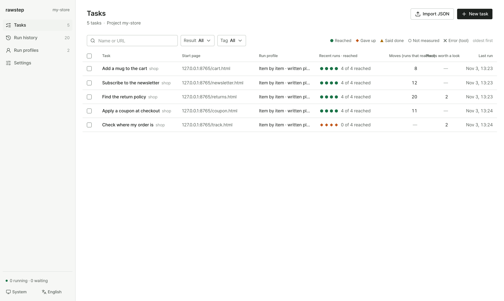
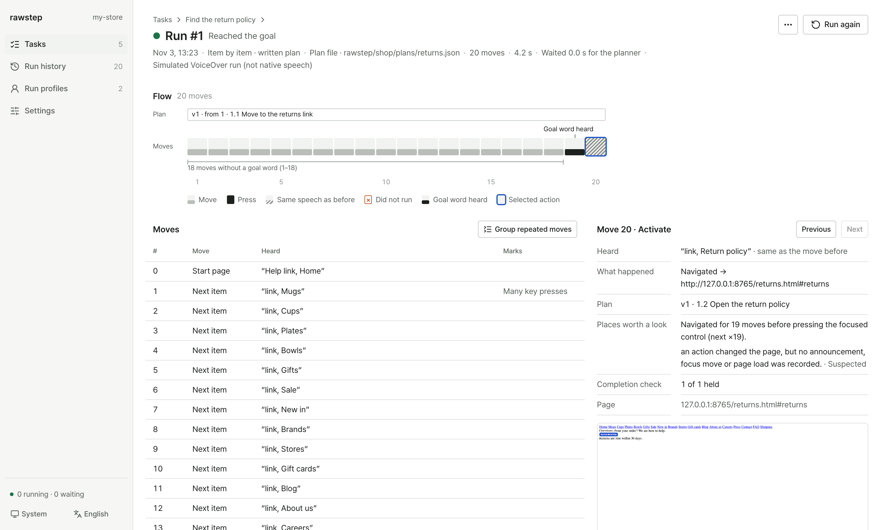

# Getting Started

Get a run going in under a minute.

## Requirements

- **Node.js** `22.12.0` or newer
- **Chrome** installed locally (or run `npx playwright install chromium`)

## Install (before the npm release)

Rawstep is not published to npm yet, so `npx rawstep` cannot fetch it from the registry. Build the package from this repository and install it into your project; after that, every `npx rawstep` command in these docs runs that local copy.

```bash
# In a clone of this repository
corepack pnpm install --frozen-lockfile
npm run pack:rawstep

# In your project
npm install /absolute/path/to/rawstep/artifacts/rawstep-<version>.tgz
```

---

## 1. Run the Built-In Demo

In your project folder, run:

```bash
npx rawstep init
npx rawstep run demo
```

This creates `rawstep.config.json` plus a demo page, task, and pre-written plan under `rawstep/demo/`, then runs the task against that local page—no API key needed. When it finishes, it prints how many moves it took and where `report.html` was saved.

---

## 2. Open the Dashboard

The easiest way to connect a model and test your own pages is the local web UI:

```bash
npx rawstep ui
```

Open `http://127.0.0.1:4318` in your browser:



1. **Connect an AI model (`Settings › AI connections`)**
   - **No API key:** If you already use **Claude Code**, **Codex**, **opencode**, **Grok**, or **Antigravity** on your machine, pick it as a provider to use your existing CLI login.
   - **API key:** To use OpenAI, Anthropic, Gemini, or OpenRouter, add your key to `.env.local`:
     ```bash
     RAWSTEP_OPENAI_API_KEY=sk-...
     RAWSTEP_ANTHROPIC_API_KEY=sk-ant-...
     RAWSTEP_GOOGLE_API_KEY=AIza...
     ```
2. **Create a run profile (`Run profiles`)**
   - Pick your model and how the user navigates (**Item by item**, **By headings**, **By form controls**, or **By links**).
3. **Add & Run a Task (`Tasks`)**
   - Enter a starting URL and a goal (for example, *"Find the wireless headphones and add them to the cart"*). Click **Get AI suggestions** to have the model propose completion checks from the live page, **Add** the ones you want, then click **Run**.

Click any run to inspect what was heard at each move and how the plan progressed:



---

## 3. Check Your Setup

If anything isn't working, run `doctor` to check your browser, config, and model connections:

```bash
npx rawstep doctor
```

---

## Next Steps

- **[Core Concepts](./concepts.md)** — Tasks, profiles, the 4 run endings, and friction hints
- **[Screen Readers & Navigation Modes](./screen-readers.md)** — Using real macOS VoiceOver or Windows NVDA
- **[CI & Baseline Regression Testing](./ci.md)** — Catching regressions in pull requests
