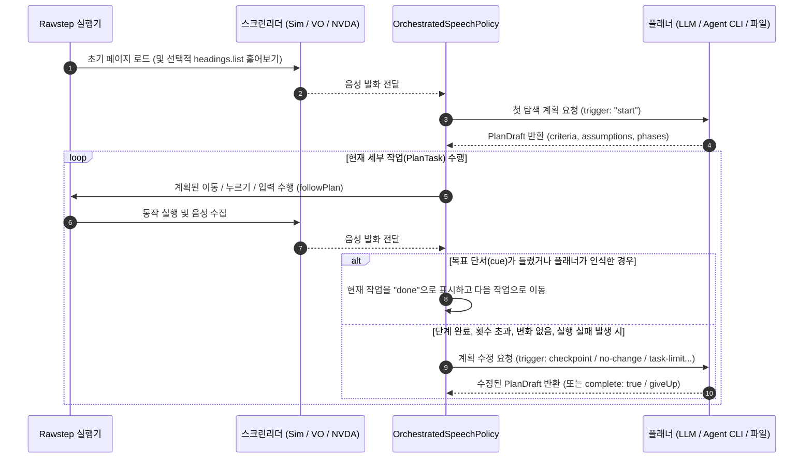

# 계획 수립 및 AI 모델

Rawstep은 키를 한 번 누를 때마다 모델을 부르지 않습니다. 플래너가 먼저 탐색 계획(`plan.md`)을 세우면, 실행기가 계획에 적힌 단계들을 차례대로 따라가다가 목표 단서를 듣거나 길이 막혔을 때만 다시 플래너를 부릅니다.

---

## 1. 계획 수립과 실행 루프의 동작 방식



### 1단계: 첫 단계 헤딩 훑어보기 (`runRules.survey`)
프로필에서 `headings.list` 명령이 허용되어 있고(예: **제목으로**) `runRules.survey`가 `"headings"`(기본값)로 설정되어 있으면, 시뮬레이션 사용자는 첫 번째 단계에서 페이지의 전체 헤딩 목록을 먼저 조회합니다. 실제 VoiceOver 사용자가 `VO+U`를 눌러 페이지 구조를 파악한 뒤 어디로 이동할지 결정하는 흐름을 본뜬 것입니다.

### 2단계: 계획 문서 작성 (`PlanDocument`)
플래너는 태스크의 `goal`, 선택적인 `context`, 허용된 `actions`, 지금까지 들은 음성 기록을 바탕으로 다음 항목들로 구성된 계획을 세웁니다.
- **완료 기준 (`C1`, `C2`, ...):** 전체 목표가 달성되었다고 판단하기 위해 사용자가 들어야 하는 확인 신호입니다.
- **가정 (`A1`, `A2`, ...):** 일반적인 UI 관습에 비추어 현재 계획이 전제하고 있는 기대입니다 (예: *"검색 버튼을 누르면 검색 결과 안내가 읽히거나 결과 헤딩으로 포커스가 이동할 것이다"*).
- **단계 및 세부 작업 (`1.1`, `1.2`, `2.1`, ...):** 순서대로 실행할 세부 작업들입니다. 각 세부 작업(`PlanTask`)은 다음을 정의합니다.
  - `goal` 및 `done`: 이 세부 작업이 하려는 일과 완료되었을 때 들릴 것으로 기대하는 내용입니다.
  - `cue`: 찾고 있는 항목에 도달했을 때 들릴 것으로 기대하는 단어입니다 (항목을 듣기 전에 쓴 추측입니다). 플래너나 계획 파일은 문자열로 쓰거나, 역할(`"button"`, `"link"`, `"heading"` 등)과 상태(`"checked"`, `"unchecked"`, `"expanded"`, `"collapsed"`, `"selected"`)를 선택적으로 붙여 `{ "name": "Add to cart", "role": "button", "state": "checked" }` 형태로 씁니다. Rawstep이 모르는 역할이나 상태는 버려집니다. 저장되는 `plan.json`에는 `cue`, `cueRole`, `cueState`로 기록됩니다.
  - **수행할 동작 (`followPlan`):**
    - **이동 작업 (`moves`):** `cue`가 들릴 때까지, 나열된 이동 명령(예: `["heading.next"]`) 중 프로필이 허용하는 첫 번째 것을 반복합니다. `moves`를 생략했거나 하나도 허용되지 않으면 한 항목씩(`next`) 이동합니다.
    - **활성화 작업 (`activates: true`):** 현재 스크린리더 커서가 위치한 항목을 누릅니다 (`activate`).
    - **입력 작업 (`types: "<inputName>"`):** 포커스된 필드를 활성화하고 선언된 태스크 입력값을 타이핑합니다 (`typeText` / `replaceText`).

### 3단계: 음성 단서 매칭 및 인식
매 동작이 끝날 때마다 Rawstep은 방금 스크린리더가 읽어준 내용을 현재 세부 작업의 `cue`와 비교합니다.
- 읽힌 텍스트가 `cue` 단어, 역할, 상태와 직접 일치하면 해당 세부 작업을 즉시 완료 처리합니다 (`verified: "heard"`).
- 읽힌 텍스트가 `cue`와 정확히 일치하지는 않지만 이름에 쓰인 단어를 일부 공유한다면, 플래너의 `recognize()` 메서드를 호출해 방금 들은 항목이 찾던 대상이 맞는지 확인합니다 (`verified: "recognized"`). 같은 세부 작업에서 같은 항목은 한 번만 묻습니다.

### 4단계: 재계획이 호출되는 시점 (`PlanTrigger`)
Rawstep은 판단이 필요한 순간에만 플래너를 다시 호출합니다.

| `trigger` | 호출 시점 |
| :--- | :--- |
| `'start'` | 실행 시작 시 첫 계획을 세울 때. |
| `'checkpoint'` | 현재 페이즈의 모든 세부 작업이 끝났을 때, 다음 페이즈로 넘어가기 전 완료 기준이 충족되었는지 점검할 때. |
| `'goal-heard'` | 현재 세부 작업이 다른 것을 찾는 중인데, 목표에 나온 이름의 항목이 처음으로 들렸을 때. |
| `'failures'` | 현재 세부 작업에서 연속으로 `runRules.failureLimit`(기본값 `2`)번 동작 실행이 실패했을 때. |
| `'no-change'` | 현재 세부 작업에서 연속으로 `runRules.noChangeLimit`(기본값 `3`)번 아무런 음성 변화가 없었을 때. |
| `'oscillation'` | 커서가 마지막으로 멈춘 항목 `4`개가 같은 두 항목을 번갈아 오갈 때(`A → B → A → B`). |
| `'task-limit'` | 현재 세부 작업에서 새로운 단서를 듣지 못한 채 `runRules.stepActionLimit`(기본값 `12`)번 이동했을 때. |
| `'effort-review'` | 플래너가 마지막으로 점검한 이후 `runRules.reviewEvery`(기본값 `60`)번의 이동이 지났을 때. |
| `'plan-finished'` | 모든 페이즈와 세부 작업이 끝났지만 아직 `complete: true`가 아닐 때, 결과를 확인해 완료 처리하거나 새 작업을 추가하거나 포기(`giveUp`)할지 결정할 때. |

모든 실행은 기계가 읽을 수 있는 **`plan.json`**과 사람이 읽기 편한 **`plan.md`**를 함께 저장하므로, 계획이 어떻게 세워지고 어떤 가정이 깨져 수정되었는지 한눈에 볼 수 있습니다.

---

## 2. 플래너 선택하기

`rawstep.config.json`의 각 실행 프로필은 다음 세 가지 방식 중 하나로 `planner`를 설정할 수 있습니다.

### 2.1 클라우드 LLM API (`openai`, `anthropic`, `google`, `openrouter`, `custom`)

```json
{
  "id": "headings-gpt",
  "name": "By Headings (GPT-4.1)",
  "planner": {
    "connectionId": "openai-main",
    "modelId": "gpt-4.1",
    "reasoningEffort": "medium",
    "instructions": ""
  },
  "actions": {
    "keys": [],
    "intents": ["next", "previous", "activate", "heading.next", "heading.previous", "headings.list"],
    "typeText": true,
    "replaceText": false
  }
}
```

### 2.2 로컬 코딩 에이전트 CLI (`claudeCode`, `codex`, `opencode`, `grok`, `antigravity`)

로컬에 설치된 코딩 에이전트 CLI가 있다면 **Agent Client Protocol (ACP)**(`@rawstep/policies/acp`)을 통해 연결할 수 있습니다. 별도의 API 키 없이 각 CLI의 로그인 세션을 그대로 사용합니다.

| `provider` | Rawstep이 실행하는 명령어 | 로그인 방법 |
| :--- | :--- | :--- |
| `claudeCode` | `npx -y @agentclientprotocol/claude-agent-acp@0.89.1` | 터미널에서 `claude` 실행 후 `/login`으로 로그인합니다. |
| `codex` | `npx -y @agentclientprotocol/codex-acp@2.2.2` | 터미널에서 `codex login`을 실행합니다. |
| `opencode` | `opencode acp` | 터미널에서 `opencode auth login`을 실행합니다. |
| `grok` | `grok agent stdio` | 터미널에서 `grok`을 한 번 실행해 로그인합니다. |
| `antigravity` | `agy_acp_server.par` (`PATH`에 있어야 함) | `npx rawstep ui`의 **설정 › AI 연결**에서 **로그인** 버튼을 누릅니다. |

> [!TIP]
> **에이전트 추론 강도 조절 (`reasoningEffort`):**
> 코딩 에이전트는 기본 추론 강도가 높게 설정된 경우가 많아(예: Codex의 기본값 `xhigh`) 계획 수립 단계가 느릴 수 있습니다. 프로필의 `planner` 객체에 `"reasoningEffort": "low"` 또는 `"medium"`을 지정하면 응답 속도를 높일 수 있습니다.

### 2.3 미리 작성된 오프라인 계획 파일 (`planFile`)

API 호출 없이 빠르고 동일하게 재현되는 실행이 필요할 때(`rawstep init`이 만드는 `demo` 태스크가 `written-plan` 프로필로 `rawstep/demo/plan.json`을 읽는 경우나 고정된 회귀 테스트 등), AI 모델 대신 JSON 계획 파일을 지정할 수 있습니다.

```json
{
  "id": "offline-plan",
  "name": "Saved Plan",
  "planner": {
    "planFile": "plans/{task}.json"
  },
  "actions": {
    "keys": [],
    "intents": ["next", "previous", "activate", "heading.next", "heading.previous", "headings.list"],
    "typeText": true,
    "replaceText": false
  }
}
```

- `{task}` 자리는 실행할 태스크 파일 이름(확장자 `.json` 제외)으로 자동 치환됩니다 (예: `tasks/checkout.json`을 실행하면 `plans/checkout.json`을 읽음).
- `planFile` 플래너(`FixedPlanner`)를 사용할 때는 실행 도중 계획이 바뀌지 않습니다. 세부 작업이 막히면(`failures`, `no-change`, `oscillation`, `task-limit`. 예를 들어 `stepActionLimit` 안에 목표 단서를 듣지 못한 경우) 해당 세부 작업을 중단하고 파일의 다음 세부 작업으로 넘어갑니다. 단계 점검과 진행 점검(`checkpoint`, `effort-review`)에서는 계획을 그대로 둡니다. 남은 세부 작업이 없는데 목표에 도달하지 못했다면, 작성된 계획의 작업이 바닥났다는 이유로 `gave-up`으로 끝납니다.
