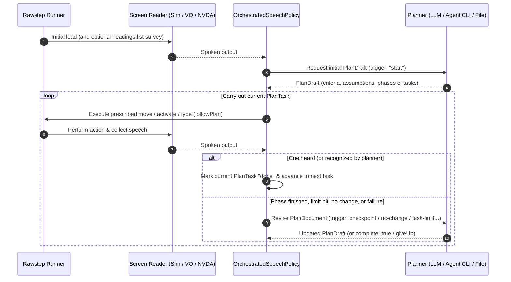

# Planning & AI Models

Rawstep does not call a language model on every keystroke. A **Planner** writes a navigation plan (`plan.md`), and the runner follows one step at a time until it hears the expected cue or needs to revise the plan.

---

## 1. How the Plan-and-Follow Loop Works



### Step 1: Optional Initial Survey (`runRules.survey`)
When a profile allows the `headings.list` intent (such as the **By headings** search strategy) and `runRules.survey` is set to `"headings"` (the default), the simulated user opens the headings list on step 1—modeled on a VoiceOver user pressing `VO+U` to scan page headings before deciding where to go.

### Step 2: Drafting the Plan Document (`PlanDocument`)
The planner receives the task's `goal`, optional `context`, the allowed `actions`, and what has been heard so far, and produces a structured plan containing:
- **Criteria (`C1`, `C2`, ...):** What the user must hear for the overall goal to count as reached.
- **Assumptions (`A1`, `A2`, ...):** Expectations from common UI conventions that the current plan relies on (for example, *"Activating the Search button will announce search results or move focus to a results heading"*).
- **Phases & Plan Tasks (`1.1`, `1.2`, `2.1`, ...):** Ordered subtasks. Each `PlanTask` specifies:
  - `goal` & `done`: What this subtask tries to do and what the user expects to hear when it finishes.
  - `cue`: The words the user expects to hear when the target item is reached (a guess, written before the item is heard). A planner or plan file writes it as a string, or as `{ "name": "Add to cart", "role": "button", "state": "checked" }` with an optional role (`"button"`, `"link"`, `"heading"`, etc.) and state (`"checked"`, `"unchecked"`, `"expanded"`, `"collapsed"`, `"selected"`); a role or state Rawstep does not know is dropped. The saved `plan.json` stores them as `cue`, `cueRole`, and `cueState`.
  - **What action to take (`followPlan`):**
    - **Movement task (`moves`):** Repeats the first listed movement intent the profile allows (e.g., `["heading.next"]`) until the `cue` is heard; with `moves` omitted, or none of them allowed, it moves item by item (`next`).
    - **Activation task (`activates: true`):** Presses (`activate`) the item currently under the screen-reader cursor.
    - **Typing task (`types: "<inputName>"`):** Activates the focused field and types the named task input (`typeText` / `replaceText`).

### Step 3: Cue Matching & Recognition
After each move, Rawstep compares what the screen reader just announced against the active subtask's `cue`:
- If the spoken output directly matches the `cue` words, role, and state, the subtask finishes immediately (`verified: "heard"`).
- If the spoken output shares name words with the `cue` without matching it exactly, Rawstep asks the planner's `recognize()` method whether the heard item is what the subtask was looking for (`verified: "recognized"`). Each heard item is asked about once per subtask.

### Step 4: Replanning Triggers (`PlanTrigger`)
Rawstep only calls the planner again when something requires a decision:

| `trigger` | When It Fires |
| :--- | :--- |
| `'start'` | Initial plan at the beginning of the run. |
| `'checkpoint'` | All tasks in the current phase finished; the planner checks whether the phase's criteria were met before moving on. |
| `'goal-heard'` | The first time the user hears an item named like the goal while the current subtask was after something else. |
| `'failures'` | `runRules.failureLimit` (default `2`) actions in a row failed to execute on the current subtask. |
| `'no-change'` | `runRules.noChangeLimit` (default `3`) actions in a row produced no change in speech on the current subtask. |
| `'oscillation'` | The cursor's last `4` stops alternate between the same two items (`A → B → A → B`). |
| `'task-limit'` | The current subtask took `runRules.stepActionLimit` (default `12`) moves without hearing anything new. |
| `'effort-review'` | `runRules.reviewEvery` (default `60`) moves have passed since the planner last reviewed progress. |
| `'plan-finished'` | All phases and tasks finished without `complete: true`; the planner inspects the outcome to either mark `complete: true`, add new tasks, or `giveUp`. |

Every run writes both the machine-readable **`plan.json`** and a human-readable **`plan.md`** into the run folder so you can read every revision, broken assumption, and rationale.

---

## 2. Choosing a Planner

Each Run Profile in `rawstep.config.json` configures its `planner` in one of three ways:

### 2.1 Cloud LLM APIs (`openai`, `anthropic`, `google`, `openrouter`, `custom`)

```json
{
  "id": "headings-gpt",
  "name": "By Headings (GPT-4.1)",
  "planner": {
    "connectionId": "openai-main",
    "modelId": "gpt-4.1",
    "reasoningEffort": "medium",
    "instructions": ""
  },
  "actions": {
    "keys": [],
    "intents": ["next", "previous", "activate", "heading.next", "heading.previous", "headings.list"],
    "typeText": true,
    "replaceText": false
  }
}
```

### 2.2 Local Coding-Agent CLIs over ACP (`claudeCode`, `codex`, `opencode`, `grok`, `antigravity`)

If you use a coding agent CLI locally, Rawstep can drive it over the **Agent Client Protocol (ACP)** (`@rawstep/policies/acp`). No API key is needed—the agent uses its own CLI login session.

| `provider` | Command Started by Rawstep | How to Sign In |
| :--- | :--- | :--- |
| `claudeCode` | `npx -y @agentclientprotocol/claude-agent-acp@0.89.1` | Run `claude` in your terminal and sign in (`/login`). |
| `codex` | `npx -y @agentclientprotocol/codex-acp@2.2.2` | Run `codex login` in your terminal. |
| `opencode` | `opencode acp` | Run `opencode auth login` in your terminal. |
| `grok` | `grok agent stdio` | Run `grok` once in your terminal and sign in. |
| `antigravity` | `agy_acp_server.par` (must be on `PATH`) | Use the **Sign in** button in `npx rawstep ui` (**Settings › AI connections**). |

> [!TIP]
> **Controlling Agent Thinking Speed (`reasoningEffort`):**
> Coding agents often default to high reasoning effort (for example, Codex defaults to `xhigh`), which can make planning turns slow. You can set `"reasoningEffort": "low"` or `"medium"` on the profile's `planner` object to speed up planning calls.

### 2.3 Offline Pre-Written Plan Files (`planFile`)

For fast, reproducible, zero-cost runs (such as the `demo` task created by `rawstep init`, which reads `rawstep/demo/plan.json` through its `written-plan` profile, or deterministic regression checks), a profile can point to a JSON plan file instead of an AI model:

```json
{
  "id": "offline-plan",
  "name": "Saved Plan",
  "planner": {
    "planFile": "plans/{task}.json"
  },
  "actions": {
    "keys": [],
    "intents": ["next", "previous", "activate", "heading.next", "heading.previous", "headings.list"],
    "typeText": true,
    "replaceText": false
  }
}
```

- `{task}` is automatically replaced with the task file's basename without `.json` (for example, `tasks/checkout.json` reads `plans/checkout.json`).
- Under a `planFile` planner, the plan never changes during a run (`FixedPlanner`): if a subtask is stuck (`failures`, `no-change`, `oscillation`, or `task-limit`, for example hitting `stepActionLimit` without hearing its cue), that subtask is abandoned and the runner moves on to the next subtask in the file. Phase checkpoints and effort reviews leave the plan as it is. When no subtask is left and the goal has not been reached, the run ends as `gave-up` because the written plan ran out of tasks.
